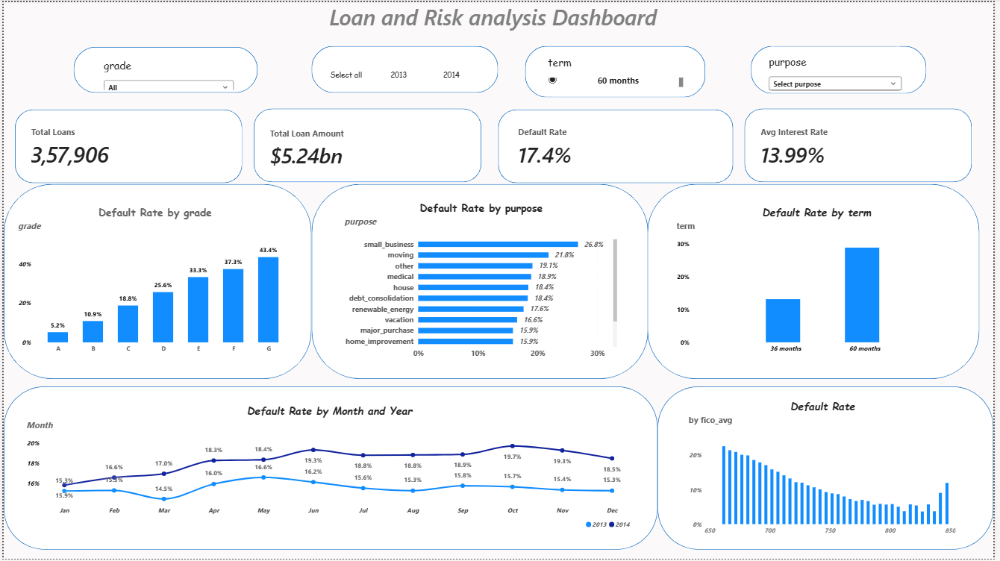

# Loan & Risk Analysis Dashboard

An interactive **Power BI dashboard** designed to analyze loan portfolio performance, borrower risk profiles, and loan default trends using data visualization, DAX measures, and data modeling.

## 📌 Project Overview

The Loan & Risk Analysis Dashboard explores lending data to identify patterns in loan defaults and assess portfolio risk. It provides an interactive view of loan performance across different loan grades, loan purposes, repayment terms, borrower FICO scores, and monthly periods.

This project demonstrates practical skills in business intelligence, data analysis, and interactive dashboard development.

## 🎯 Project Objectives

* Analyze loan portfolio performance and lending trends.
* Monitor loan defaults and default rates.
* Explore relationships between borrower credit scores and loan defaults.
* Compare risk patterns across loan grades, purposes, and loan terms.
* Present key metrics through an interactive dashboard.

## 📸 Dashboard Preview

*Interactive Power BI dashboard for loan portfolio and risk analysis.*
## 📊 Key Performance Indicators (KPIs)

* **Total Loans** — Total number of loans in the dataset.
* **Total Loan Amount** — Combined value of loans.
* **Default Rate** — Proportion of loans classified as defaults.
* **Average Interest Rate** — Average interest rate across the analyzed loans.

## 🔍 Dashboard Features

* Default-rate analysis by loan grade and loan purpose.
* Comparison of default rates across loan terms.
* Monthly trends in loan default rates.
* Default-rate analysis across borrower FICO scores.
* Interactive slicers for year, grade, term, and purpose.
* KPI cards for a quick overview of portfolio performance.

## 🛠️ Tools & Technologies

* **Microsoft Power BI Desktop** — Dashboard development and reporting.
* **DAX** — Measures and analytical calculations.
* **Data Modeling** — Organizing data and relationships.
* **Data Visualization** — Interactive charts, KPI cards, and slicers.

## 📁 Project File

[📊 Download the Power BI Dashboard (.pbix)](./Loan%20%26%20Risk%20Analysis%20dashboard.pbix)

Download the file and open it using Microsoft Power BI Desktop to explore the interactive report.

## 💡 Key Insights

* **Portfolio Overview:** The dashboard reports 357,906 loans with a total loan amount of $5.24 billion.
* **Default Rate:** The displayed overall loan default rate is 17.4%.
* **Loan Grade Risk:** Grade G has the highest displayed default rate at 43.4%, while Grade A has the lowest at 5.2%.
* **Loan Purpose:** Small business loans show the highest default rate among the purposes visible in the chart, at 26.8%.
* **Loan Term:** The dashboard shows a higher default rate for 60-month loans than for 36-month loans.
* **Monthly Trends:** Default rates vary across months and between the displayed 2013 and 2014 series.
* **Borrower Credit Scores:** Default rates vary across the FICO score ranges shown in the dashboard.

*Note: These observations reflect the displayed dashboard and its current filter selections.*

The dashboard can be used to explore:

* How default rates vary across loan grades and purposes.
* Whether loan terms show different default patterns.
* How borrower FICO scores relate to observed loan defaults.
* How default rates change over time.

*Actual findings should be documented after reviewing the dashboard results and underlying dataset.*

## 🚀 How to Use

1. Open the PBIX download link above.
2. Download the Power BI dashboard file.
3. Install and launch Microsoft Power BI Desktop.
4. Open the downloaded `.pbix` file.
5. Explore the report using the available visuals and slicers.

## 🎓 Project Purpose

This project was developed as a data analytics portfolio project to demonstrate skills in Power BI dashboard design, DAX, data modeling, and interactive business reporting.

## ⚠️ Disclaimer

This project is intended for educational and portfolio demonstration purposes only. The analysis depends on the underlying dataset and its definitions. The dashboard should not be used as the sole basis for real-world lending or credit decisions.
